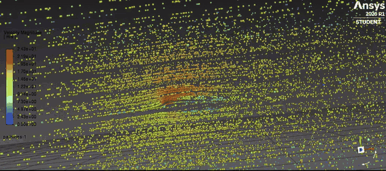
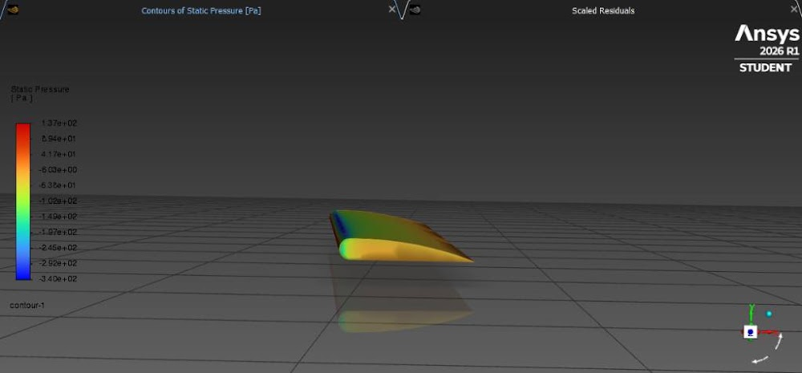
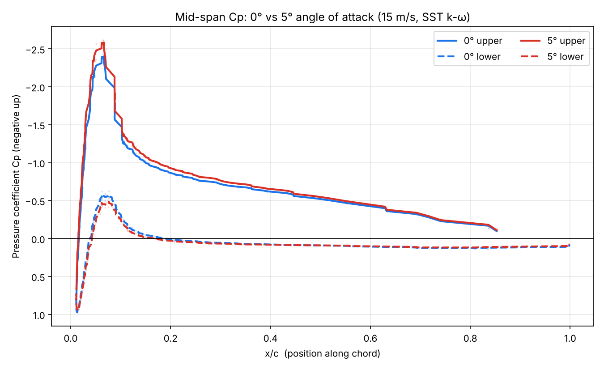

# Airfoil CFD Project: Tapered Wing at 0° and 5°


A first CFD project: I designed a small tapered wing in SolidWorks and simulated the air flowing over it in Ansys Fluent, to see what working in aerospace engineering feels like. I compared the pressure on the wing at 0° and 5°. I made this because I was curious on what type of work I would be doing in aerospace engineering.





## Key result



- The top of the wing has a strong suction peak near the front (Cp about -2.4 at 0°, about -2.6 at 5°, around x/c = 0.07), then recovers toward the back. The bottom stays close to zero. This is the pressure difference that makes a wing lift.
- **The 0° and 5° curves came out much closer than they should.** I think this is because I made the 5° case by tilting the air coming into the box instead of rotating the wing (see Limitations).


## Setup

| Item | Value |
|---|---|
| Software | Ansys Fluent 2026 R1 (student), SolidWorks |
| Geometry | Cambered airfoil, flat bottom, sharp trailing edge, tapered 3D wing |
| Size (approx.) | Span about 0.5 m, chord about 0.07 to 0.09 m (check against your CAD) |
| Air speed | 15 m/s |
| Fluid | Air, density 1.225 kg/m³ |
| Reynolds number (approx.) | about 80,000 (based on mid-span chord) |
| Solver | 3D, double precision, pressure-based, steady |
| Turbulence model | SST k-ω |
| Cases | 0° (inlet straight on) and "5°" (inlet tilted 5°) |
| Mesh | [FILL IN: number of cells, anything special you did] |
| Domain | Enclosed wind-tunnel-style box ([FILL IN: dimensions]) |


## What's in this repo

```
01_CAD_Models/        SolidWorks wing and the wind tunnel geometry
02_Simulation_Files/  Exported Fluent data (CSV) for 0° and 5°
03_Results/           Plots, pressure contour, residuals, pathlines video
process.md            Step-by-step story of how I built this
```

The full Ansys Workbench project is too large for the repo. [FILL IN: link to Release or Google Drive.]

## Limitations 

- **The 5° case is not a true 5° angle of attack.** I tilted the inlet velocity 5° inside an enclosed box. The walls probably straightened the flow before it reached the wing, so the wing saw far less than 5°. The right fix is to rotate the wing 5° in CAD and re-mesh, or to use a much bigger open domain.
- No mesh independence study, so I don't know how much the results depend on the mesh.
- No validation against wind tunnel or published data.
- The Cp curves are from node values on one slice at mid-span, split into upper and lower surface and lightly smoothed, so they're noisy near the nose.
- Student license of Fluent, so mesh size is limited.

## What I learned

- Fluent's default reference velocity is 1 m/s. My first Cp values were about 225 times too large (15² = 225) until I set the reference values from the inlet.
- Exporting data before the solver has run gives all zeros. Always check the contour first.
- Residuals that stop dropping are not the same as a bad run. The solver can also stop early on its own.
- Sanity-checking results against expectations (does a 5° change look big enough?) is how I caught my own mistake.

## What I'd do next

1. Rotate the wing 5° in SolidWorks, re-mesh, and run again with the inlet straight on.
2. Add a mesh independence check.
3. Compare my Cp curve with published data for a similar airfoil.

## Credits and AI use

Wing design, meshing, simulation setup and runs are my own work. AI (Claude) was used to help clean up the exported data, make the plots, and polish this write-up.
