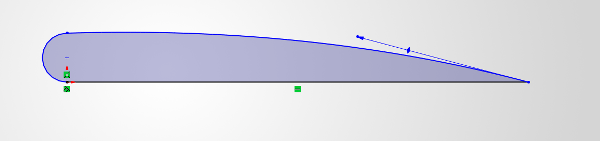
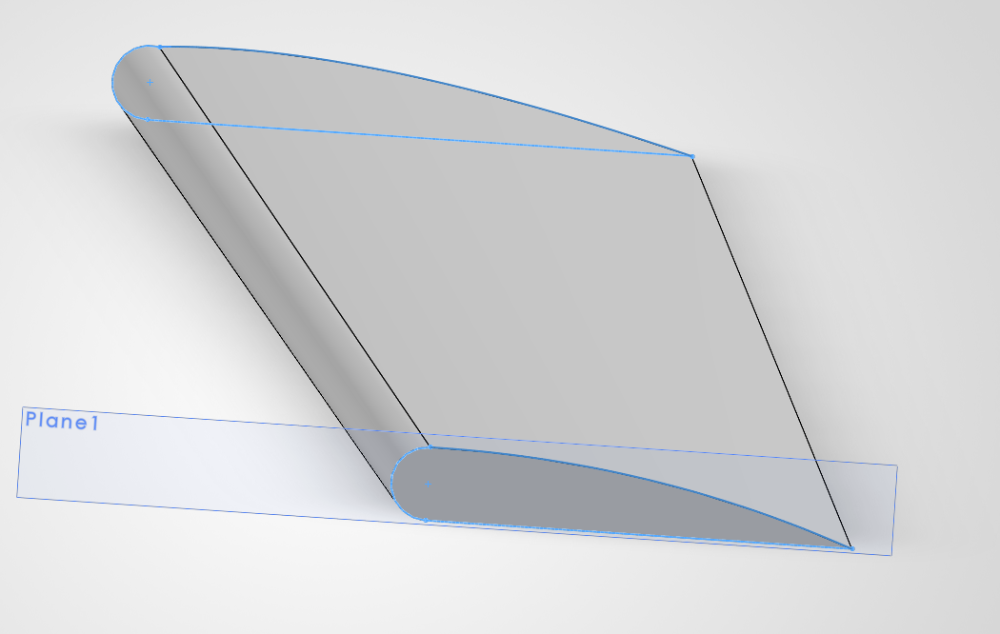
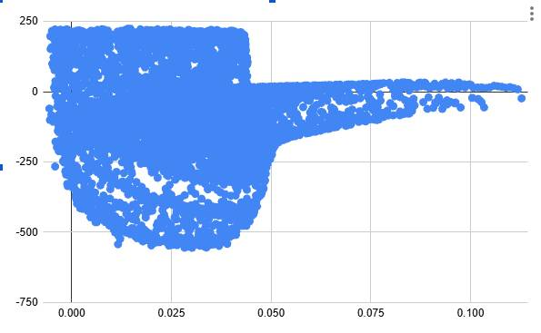
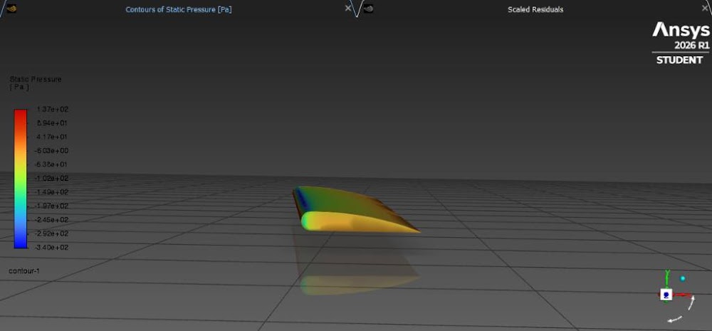
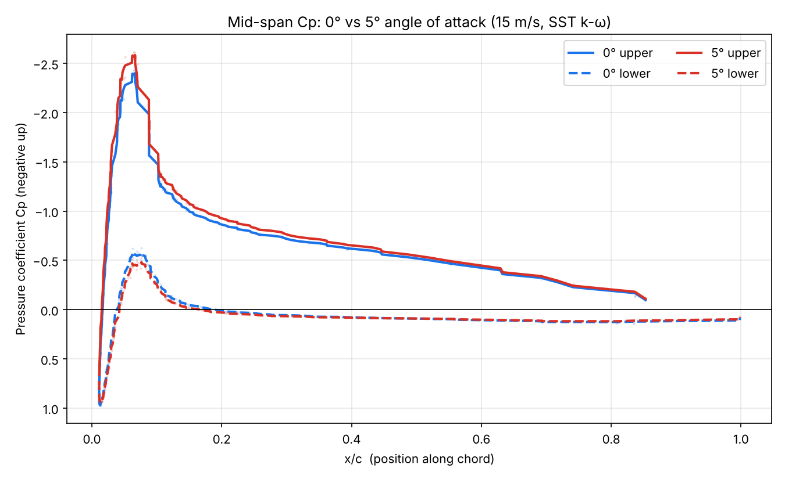
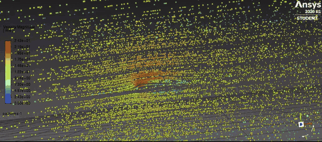

# How I Built This: Step by Step

[← Back to the main README](README.md)

## Step 1: Sketching the airfoil

I started by sketching the airfoil in SolidWorks and settled on a cambered shape with a rounded nose, a flat bottom and a sharp trailing edge. I chose this shape because I based it off of my memory consisting of many airfoils.(E.G Gottingen 398 1919) 

## Step 2: Turning it into a 3D wing

I extruded the sketch into a tapered wing, narrower at one end than the other, with a slightly slanted leading edge. I did this by first projecting another plane 500mm Infront of the first one. I then started sketching a smaller version of the airfoil and set it down, having the midway point be the end of the original sketch. After that, I lofted the two sketches together, creating the wing.  

## Step 3: Building the wind tunnel and meshing

I put the wing inside an enclosed box (the "wind tunnel") and meshed it in Ansys. For the box dimensions, it was 125mm on all sides except the back(the back being 500mm)

## Step 4: Setting up Fluent

- 3D, pressure-based, steady, SST k-ω turbulence model
- Air at 15 m/s coming in straight at the inlet, outlet at the other end
- Reference values computed from the inlet

## Step 5: First results, and my first mistakes

My first exports looked wrong, and tracking down why taught me the most.

1. **The 0° file was all zeros.** I had exported before running the solver.
2. **Cp values were around -555 to +224**, when a wing should give about -3 to +1. Fluent's reference velocity was still at its default of 1 m/s, so the numbers were about 225 times too big (15 × 15 = 225).
3. **The residuals had only run 18 iterations** and hadn't settled yet.
4. **The plot looked like a blob.** I only exported x and Cp, but the wing is 3D, so top, bottom and different spots along the span all sat at the same x. I needed x, y and z.

## Step 6: Running it properly and exporting

I set the reference values from the inlet, ran the 0° case until the residuals flattened (it stopped by itself at about 154 iterations), and exported the wing surface with x, y, z and pressure coefficient.

## Step 7: Making the plot

I took a slice at mid-span, worked out each point's position along the chord (x/c), split the points into upper and lower surface, and smoothed each curve a little.

## Step 8: The 5° case, and what it taught me

To get 5°, I tilted the inlet velocity instead of rotating the wing. The result was only slightly different from 0°. My explanation is that the walls of the enclosed box straightened the flow before it reached the wing. I checked this with the path lines near the outlet

Lesson: in a closed tunnel, rotate the model. Tilting the inlet only works in a big, open domain.

## Pathlines

Full video: [pathlines_web.mp4](03_Results/pathlines_web.mp4)

## What I'd change next time

1. Defiantly rotate the wing for the 5° case, or at least in this specific example.
2. Use a mesh independence check.
3. Compare with published data.

## Final thoughts

In my opinion, I definitely had fun working on this project. It allowed me to experience just a fraction of the engineering process, especially considering this was my first project. Although the results I obtained were not perfect, being able to experiment with CFD, CAD, and creating a GitHub repository was genuinely enjoyable.

If I were to repeat this project, I would definitely rotate the wing rather than the inlet. The reason is that the results were only slightly different from the 0° case, something that might have been avoided with a better approach to setting up the simulation.

Another thing I would like to explore is comparing my results with published aerodynamic data. I would love to see how well my results hold up against existing research and use that comparison to identify areas for improvement.

Overall, I consider this a successful first project. To whoever is reading this, thank you!
